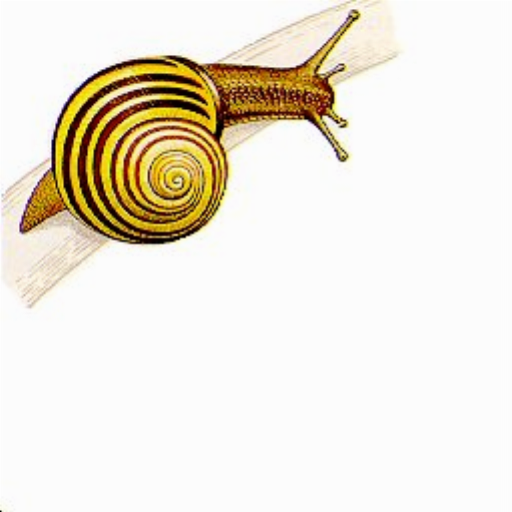

# Bilinear Image Scaling in RISC-V Assembly

Project for the *Computer Architecture* course, Warsaw University of Technology

Resizes a 24-bit BMP image to any width and height using **bilinear interpolation**, written entirely in RISC-V assembly and run in the [RARS](https://github.com/TheThirdOne/rars) simulator

| Input (256×256) | Upscaled to 512×512 | Stretched to 400×200 | Downscaled to 64×64 |
| :---: | :---: | :---: | :---: |
|  |  |  |  |

## How it works

For every pixel of the output image, the program maps its position back onto the source image and blends the four nearest source pixels (Q11, Q21, Q12, Q22), weighted by distance:

```
P = Q11*(1-dx)(1-dy) + Q21*dx(1-dy) + Q12*(1-dx)dy + Q22*dx*dy
```

Implementation details:

- **Fixed-point arithmetic (Q16.16).** There is no floating point. Scale factors, source coordinates and the weights `dx`, `dy` are 16.16 fixed-point numbers, so interpolation uses only integer `mul`, shifts and masks.
- **BMP parsing by hand.** The width and height fields in the 54-byte BMP header are not word-aligned, so they are rebuilt from two aligned word loads with shifts.
- **Row padding.** BMP rows are padded to a multiple of 4 bytes. The program computes the padded row size for both input and output images.
- **Bottom-up layout.** BMP stores rows from the bottom, so row offsets are mirrored when reading and writing pixels.
- **Edge handling.** Neighbour coordinates are clamped to the last row and column, so border pixels never read outside the image.
- **Dynamic memory.** Input and output pixel buffers are allocated on the heap with the `sbrk` syscall. The output header is a patched copy of the input header.

## Running

Requirements: Java and [RARS 1.6](https://github.com/TheThirdOne/rars/releases)

1. Put a 24-bit BMP named `input.bmp` next to `image_scaling.asm`.
2. Run from that directory:

   ```bash
   java -jar rars1_6.jar sm image_scaling.asm
   ```

   `sm` starts execution at `main`. In the RARS GUI, enable *Settings -> Initialize Program Counter to global 'main' if defined*
3. Enter the new width and height. The result is saved as `output.bmp`.

## Limitations

- Supports uncompressed 24-bit BMP files only
- New width and height must be at least 2